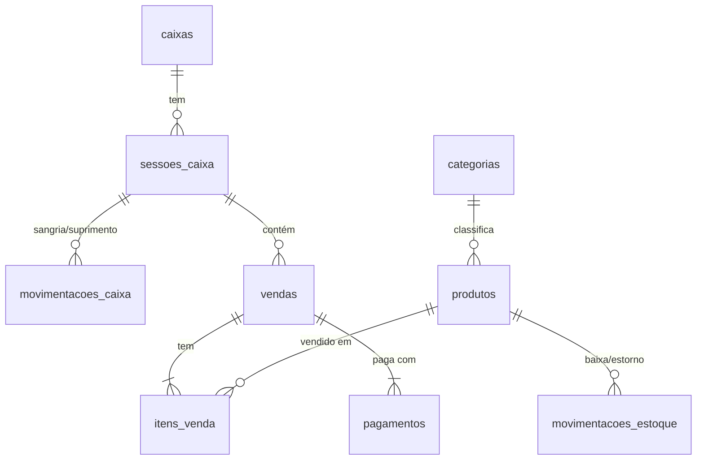

# Diagrama Entidade-Relacionamento — ERP Padaria

Gerado a partir dos modelos SQLAlchemy em `backend/app/models/`.
21 tabelas, agrupadas por domínio. Visualize no GitHub, no VS Code (extensão *Markdown Preview Mermaid Support*)
ou colando o bloco em <https://mermaid.live>.

**Legenda:** `PK` chave primária · `FK` chave estrangeira · `UK` valor único
· `||--o{` um-para-muitos · `|o--o{` relação opcional (FK pode ser nula)

---

## 1. Visão geral

```mermaid
erDiagram
    %% ───────────── Pessoas e acesso ─────────────
    usuarios {
        int id PK
        string uuid UK
        string nome
        string email UK
        string senha_hash
        enum perfil "super_admin | admin | gerente | caixa | estoquista | sync_pdv"
        bool ativo
        datetime created_at
        datetime updated_at
        datetime deleted_at "soft delete"
    }

    clientes {
        int id PK
        string nome
        string telefone
        string email
        string cpf UK
        date data_nascimento
        text observacao
        decimal pontos_fidelidade
        datetime deleted_at "soft delete"
    }

    %% ───────────── Catálogo ─────────────
    categorias {
        int id PK
        string nome "UK junto com parent_id"
        text descricao
        bool ativo
        int parent_id FK "auto-relacionamento (subcategoria)"
    }

    fornecedores {
        int id PK
        string razao_social
        string cnpj UK
        string telefone
        string email
        bool ativo
        datetime deleted_at "soft delete"
    }

    produtos {
        int id PK
        string codigo_barras UK "999 = Diverso"
        string sku UK
        string nome
        string fabricante
        int categoria_id FK
        int fornecedor_id FK
        enum unidade_medida "un | kg | g | l | ml | pct"
        decimal preco_custo
        decimal preco_venda
        decimal estoque_atual "3 casas"
        decimal estoque_minimo
        decimal estoque_maximo
        bool ativo
        datetime deleted_at "soft delete"
    }

    %% ───────────── Caixa ─────────────
    caixas {
        int id PK
        string nome UK
        string descricao
        bool ativo
    }

    sessoes_caixa {
        int id PK
        int caixa_id FK
        int usuario_id FK
        enum status "aberto | fechado"
        decimal valor_abertura
        decimal valor_fechamento
        decimal total_vendas
        decimal total_sangrias
        decimal total_suprimentos
        decimal diferenca
        datetime opened_at
        datetime closed_at
    }

    movimentacoes_caixa {
        int id PK
        int sessao_id FK
        enum tipo "sangria | suprimento"
        decimal valor
        string motivo
        int usuario_id FK
        datetime created_at
    }

    %% ───────────── Vendas ─────────────
    vendas {
        int id PK
        string uuid UK
        int sessao_id FK
        int usuario_id FK "operador"
        int cliente_id FK
        enum status "rascunho | concluida | cancelada"
        decimal subtotal "soma dos itens"
        decimal desconto_valor
        decimal desconto_pct
        decimal total "subtotal - desconto"
        decimal troco
        int cancelado_por FK
        datetime cancelado_em
        text motivo_cancelamento
        datetime created_at "horário de São Paulo"
    }

    itens_venda {
        int id PK
        int venda_id FK
        int produto_id FK
        decimal quantidade "3 casas (kg)"
        decimal preco_unit "foto do preço na venda"
        decimal custo_unit "foto do custo na venda"
        decimal desconto_unit
        decimal total_item
    }

    pagamentos {
        int id PK
        int venda_id FK
        enum forma "dinheiro | cartao_credito | cartao_debito | pix | vale"
        decimal valor "líquido do troco"
        string nsu "guarda a maquineta"
        enum status "pendente | aprovado | recusado"
        int operadora_id FK
        enum bandeira "visa | master | elo | amex | hipercard | outra"
        int parcelas
        datetime created_at
    }

    %% ───────────── Estoque e compras ─────────────
    movimentacoes_estoque {
        int id PK
        int produto_id FK
        enum tipo "entrada | saida | ajuste | perda | devolucao | venda"
        decimal quantidade
        decimal saldo_antes
        decimal saldo_depois
        decimal custo_unit
        int referencia_id "id em vendas ou compras (sem FK)"
        enum referencia_tipo "venda | compra | ajuste_manual"
        int usuario_id FK
        text observacao
        datetime created_at
    }

    compras {
        int id PK
        int fornecedor_id FK
        int usuario_id FK
        enum status "rascunho | confirmado | recebido | cancelado"
        decimal total
        string nota_fiscal
        date data_entrega
    }

    itens_compra {
        int id PK
        int compra_id FK
        int produto_id FK
        decimal quantidade
        decimal custo_unit
        decimal total_item
    }

    %% ───────────── Financeiro ─────────────
    contas_bancarias {
        int id PK
        string banco
        string agencia
        string conta
        enum tipo "corrente | poupanca"
        bool ativo
    }

    lancamentos_bancarios {
        int id PK
        int conta_bancaria_id FK
        date data
        text descricao
        decimal valor "sempre positivo"
        enum tipo "credito | debito"
        string fitid "UK junto com conta (OFX)"
        bool conciliado
        enum conciliado_tipo "venda | pagamento | ajuste_manual"
        int conciliado_ref_id "id em vendas ou pagamentos (sem FK)"
        datetime conciliado_em
        int conciliado_por FK
    }

    operadoras_cartao {
        int id PK
        string nome UK
        bool ativo
    }

    taxas_cartao {
        int id PK
        int operadora_id FK
        enum bandeira
        enum tipo "debito | credito_vista | credito_parcelado"
        int parcelas
        decimal taxa_percentual
        int dias_recebimento
    }

    %% ───────────── Sistema ─────────────
    logs_auditoria {
        int id PK
        int usuario_id FK
        string entidade "nome da tabela"
        string entidade_id "id do registro (sem FK)"
        enum acao "criar | editar | deletar | login | logout | cancelar | ajuste"
        json dados_anteriores
        json dados_novos
        string ip_address
        string user_agent
        datetime created_at
    }

    configuracoes_empresa {
        int id PK
        string nome
        string cnpj
        string telefone
        string endereco
        string logo_url
        string mensagem_rodape
        string smtp_host
        int smtp_port
        string smtp_user
        string smtp_senha
        bool smtp_tls
        bool smtp_ssl
    }

    %% ───────────── Relacionamentos ─────────────
    categorias      |o--o{ categorias            : "subcategoria de"
    categorias      ||--o{ produtos              : "classifica"
    fornecedores    |o--o{ produtos              : "fornece"

    caixas          ||--o{ sessoes_caixa         : "tem"
    usuarios        ||--o{ sessoes_caixa         : "abre"
    sessoes_caixa   ||--o{ movimentacoes_caixa   : "registra"
    usuarios        ||--o{ movimentacoes_caixa   : "faz"

    sessoes_caixa   ||--o{ vendas                : "contém"
    usuarios        ||--o{ vendas                : "vende"
    usuarios        |o--o{ vendas                : "cancela"
    clientes        |o--o{ vendas                : "compra"
    vendas          ||--|{ itens_venda           : "tem"
    produtos        ||--o{ itens_venda           : "vendido em"
    vendas          ||--|{ pagamentos            : "paga com"
    operadoras_cartao |o--o{ pagamentos          : "processa"

    produtos        ||--o{ movimentacoes_estoque : "movimenta"
    usuarios        ||--o{ movimentacoes_estoque : "registra"

    fornecedores    ||--o{ compras               : "vende para"
    usuarios        ||--o{ compras               : "lança"
    compras         ||--|{ itens_compra          : "tem"
    produtos        ||--o{ itens_compra          : "comprado em"

    contas_bancarias  ||--o{ lancamentos_bancarios : "extrato"
    usuarios          |o--o{ lancamentos_bancarios : "concilia"
    operadoras_cartao ||--o{ taxas_cartao          : "cobra"

    usuarios        |o--o{ logs_auditoria        : "gera"
```

---

## 2. Foco: fluxo de venda (o que alimenta caixa, dashboard e relatórios)

| Indicador | Vem de |
|-----------|--------|
| Faturamento bruto | `SUM(vendas.subtotal)` — status `concluida` |
| Faturamento líquido / Ticket médio | `SUM(vendas.total)` / `COUNT(vendas.id)` |
| Descontos | `SUM(vendas.desconto_valor)` |
| Custo total / Lucro | `SUM(itens_venda.custo_unit × quantidade)` |
| Relatório por produto / categoria / Curva ABC | `itens_venda.total_item` + `produtos` + `categorias` |
| Fechamento por forma de pagamento | `SUM(pagamentos.valor)` agrupado por `forma` |
| Maquinetas | `pagamentos.nsu` (forma cartão) |
| Total da sessão | `sessoes_caixa.total_vendas` (atualizado a cada venda/cancelamento) |

---

## 3. Observações do modelo

- **Preço e custo "congelados":** `itens_venda.preco_unit` e `custo_unit` guardam o valor do momento da venda.
  Mudar o produto depois não altera o histórico.
- **Referências sem FK (polimórficas):**
  - `movimentacoes_estoque.referencia_id` → `vendas.id` ou `compras.id`, conforme `referencia_tipo`.
  - `lancamentos_bancarios.conciliado_ref_id` → `vendas.id` ou `pagamentos.id`, conforme `conciliado_tipo`.
  - `logs_auditoria.entidade_id` → qualquer tabela indicada em `entidade`.

  O banco não garante a integridade dessas referências, só a aplicação.
- **Soft delete** (`deleted_at`): `usuarios`, `clientes`, `fornecedores`, `produtos`.
- **Datas** são gravadas no horário de São Paulo, sem fuso (`agora()` em `app/utils/tempo.py`; fuso em `REPORT_TIMEZONE`).
  Registros anteriores a essa mudança estão em UTC (3h adiantados) e não foram convertidos.
- **`pagamentos.nsu`** guarda hoje o nome da maquineta, não o NSU da transação.
- **`configuracoes_empresa`** é uma tabela de linha única, sem relacionamentos.
- **Únicos compostos:** `categorias (nome, parent_id)`, `lancamentos_bancarios (conta_bancaria_id, fitid)`,
  `taxas_cartao (operadora_id, bandeira, tipo, parcelas)`.
